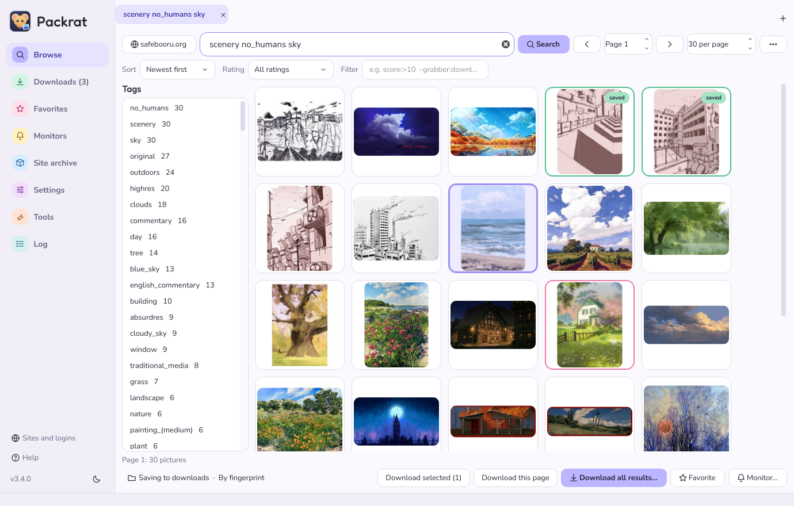

# Packrat

Packrat finds, downloads and organizes pictures and videos from image boards: Danbooru, Gelbooru, e621, e926,
e6ai, yande.re, Konachan, rule34, Safebooru, Sankaku, Zerochan, Pixiv and many more. It runs
Grabber's site sources, so any site Grabber supports works here too.
It can also keep a complete, verified copy of e6ai or e621.

Windows 10 / 11 and macOS 12 or newer (new in 3.2.1). Linux works from source.



## Download

| | Download | Then |
| :- | :- | :- |
| **Windows** | **[Packrat-windows.zip](../../releases/latest/download/Packrat-windows.zip)** | Unzip to `C:\`, double-click `Packrat.exe` |
| **Mac** (M1 or newer) | **[Packrat-macOS.dmg](../../releases/latest/download/Packrat-macOS.dmg)** | Open it, drag Packrat into Applications |
| Any computer with Python 3.11 - 3.14 | [Packrat-python.zip](../../releases/latest/download/Packrat-python.zip) | Unzip; Windows: `Start Packrat.bat`, Mac / Linux: `Start Packrat.command` |

Nothing else to install. The programs are not signed by Microsoft or Apple, so the first start shows a warning:

- **Windows** - "Windows protected your PC": click "More info" > "Run anyway".
- **Mac** - "Apple could not verify Packrat": click **Done**, open **System Settings > Privacy & Security**, scroll
  down to "Packrat was blocked" and click **Open Anyway**, then **Open Anyway** again. Only the first time.
  An Intel Mac uses Packrat-python.zip (install Python from [python.org](https://www.python.org/downloads/macos/)
  first).

On a Mac, Packrat keeps its settings in `~/Library/Application Support/Packrat` and saves pictures to
**Pictures > Packrat** (change it in Settings). Logins go in the Mac's Keychain.

Both links always point at the newest version. Older ones are under [Releases](../../releases).

`START HERE - README.txt` in either download has the step-by-step instructions.

## What it does

- **Browse** several sites at once: thumbnail grid, tag list in colours, tag completion and coloured words in the
  search box, filters, blacklist.
- **One search language for every site**: the **Sort** (most popular, most favorited, oldest, random) and **Rating**
  (safe for work, sensitive, questionable, explicit, no explicit) menus work on every site. Packrat writes them the
  way each site wants (`order:popular` becomes `order:score` on Danbooru, `sort:score` on Gelbooru, `order:toplist`
  on Wallhaven ...) and filters the results itself where a site can't.
- **Set up a site** step by step: what an account changes there, a button to the page with your API key, a test;
  or use the login you already have in your browser (Firefox everywhere; Chrome, Edge, Brave, Safari on a Mac).
- **View** pictures with zoom; videos and animated pictures play inside Packrat.
- **Download** whole searches or picked pictures. Sites download side by side, each at its own polite speed. Stop
  any time; Start continues. Pictures you already have are recognised by MD5, also across sites. A transfer that
  breaks halfway is continued, not restarted.
- **Name and sort files** with Grabber's file name tokens (`%artist%/%id%.%ext%`), conditions and JavaScript.
- **Favorites and monitors**: keep searches, see what is new, download new pictures automatically. Packrat can sit
  next to the clock and keep checking.
- **Logins**: API keys and passwords in the Windows Credential Manager (on a Mac: the Keychain), your own
  browser's login, or log in on the site's own page in the built-in browser.
- **Site archive**: a complete copy of e6ai or e621 from the sites' daily exports, checked file by file.
- **Tools**: import everything from Grabber, rename existing files, fix lists, load tag lists. Saved pictures can
  be uploaded to your own booru (Szurubooru, Danbooru, Shimmie, MyImouto).
- Help is built in (F1), and every feature is also on the command line (`packrat --help`).

## Safety

- Logins (passwords, API keys, tokens) are kept in the Windows Credential Manager or the Mac Keychain, never in
  settings files, and
  are only sent to the site they belong to - not to the servers that host its files.
- Your API key is never written into saved files, logs, file names or copied addresses.
- Commands you set to run after saving (Settings > Commands) can't be hijacked by tag names from a site.

What changed in each version: [Change log](docs/CHANGELOG.md). Latest: **3.3.1** (Danbooru works again; clearer Zerochan searches).

## Not there yet

- English only. No auto-update. No custom themes.
- Sites that need an account (Pixiv, Twitter/X) and the built-in login browser have not been tested with real
  accounts.
- `Packrat.exe` and `Packrat.app` are not code-signed.
- The Mac version is new: the tests and the window self-test pass on every change, but it has had less real use
  than the Windows one. Hourly monitor checks while Packrat is closed and desktop / Start menu shortcuts are
  Windows only. The .dmg is for Apple Silicon Macs (M1 and newer).

## From source

```
git clone https://github.com/Kasakir-AI/Packrat.git
cd Packrat/app
python -m pip install -e . pytest
python -m pytest -q
python -m packrat gui
```

Every push and every pull request is tested on GitHub's Windows and Mac machines: the start-up scripts, the tests, a
self-test of the window, and the `Packrat.exe` / `Packrat.app` builds ([workflow](.github/workflows/windows.yml)).
A merge into `main` publishes the new version (Windows zip, Mac .dmg, Python zip) on the Releases page by itself.

To build the Mac app yourself: `cd app && python -m pip install -e . pyinstaller && python -m PyInstaller packrat.spec`
gives `app/dist/Packrat.app`.

## More

- [Manual](docs/README.md) - [Site archive manual](docs/SITE-ARCHIVE.md) - [Change log](docs/CHANGELOG.md)
- The site sources come from Grabber by Bionus (Apache License 2.0); the license text is in `app/packrat/sources/`.
- This project was called e6ai-archiver until version 3.0. Old archives and settings are picked up automatically.
