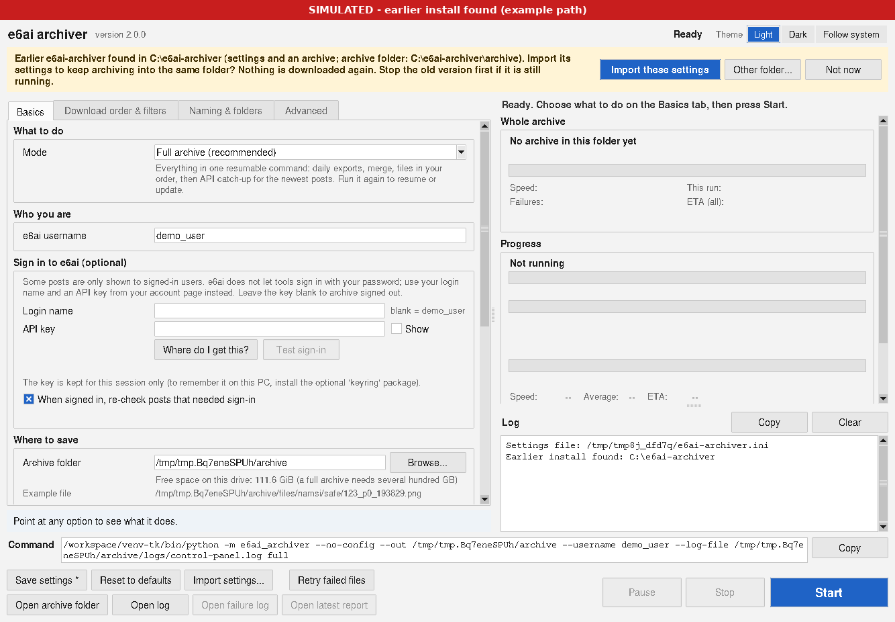
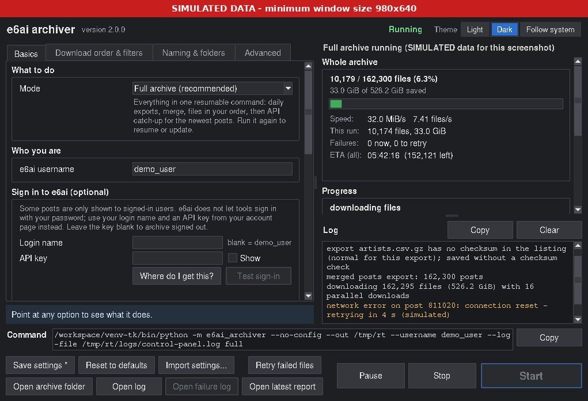
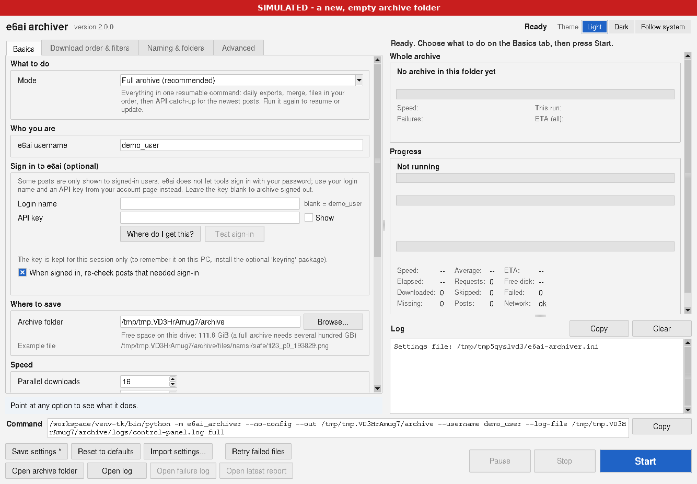
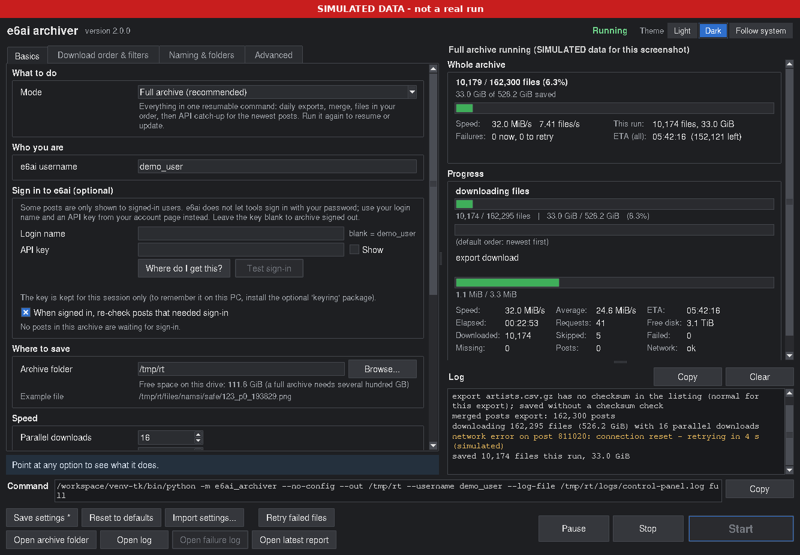
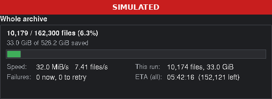
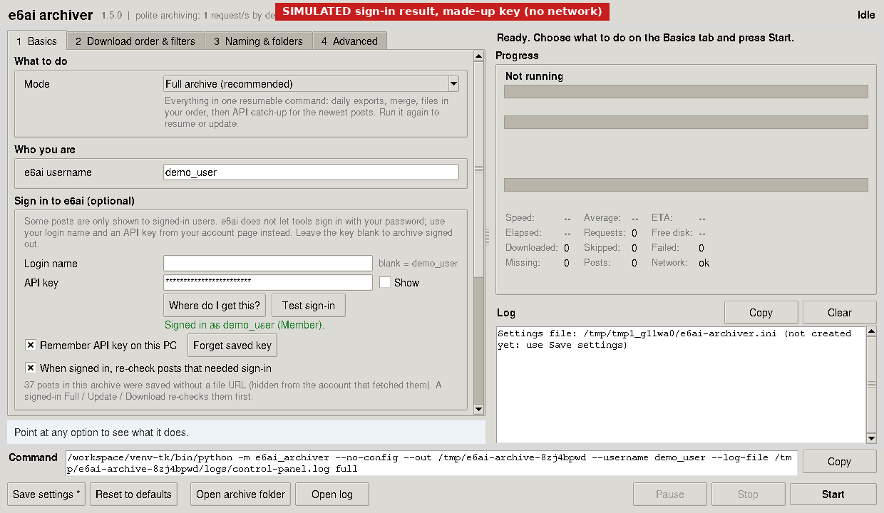
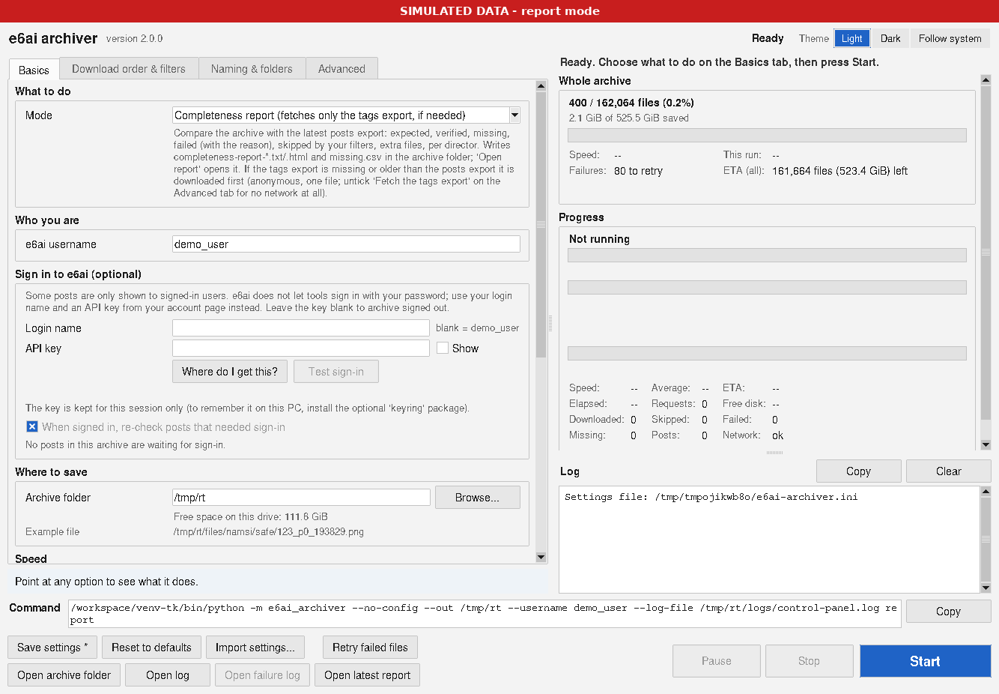
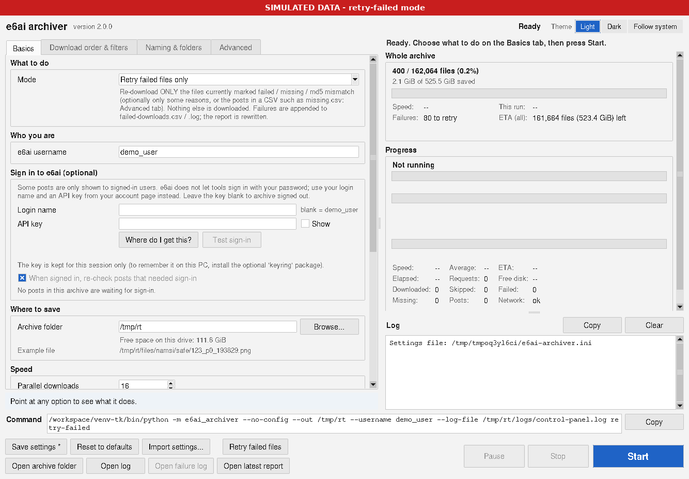

# Packrat site archive

> **This is the manual of the *Site archive* tab** - the whole e6ai-archiver 2.0, kept as it was and now part of
> Packrat 3.0. Packrat's main manual (Browse, Downloads, file names, favorites, monitors ...) is
> [README.md](README.md). In Packrat the archive also works for **e621** (`--site e621`, or "Site" in the tab);
> everything below applies to both. Commands below: `.\run.ps1` means `.\app\run.ps1`, run from the Packrat
> folder; `e6ai-archiver.ini` is now `packrat.ini` and `E6AI_*` variables are now `PACKRAT_*` (the old names
> still work). Most people only need **Start Packrat.bat** > **Site archive** tab.


A polite, resumable archiver for **e6ai.net** posts. It downloads every post's original file
(image or video) plus its full metadata through the site's **official JSON API** (the e621ng
codebase, same API as e621) and the official **daily database exports**. It never scrapes HTML.

**Version 2.0** is the distribution release: a zip with a friendly folder (**Start Packrat.bat**,
**START HERE - README.txt**, `app\`, `docs\`), a fixed **Whole archive** dashboard (it now agrees with
Progress and shows an ETA), a polished window, an **Import settings** button, and safe upgrades from 1.6 -
1.9.1 (automatic database backup + transactional upgrade, nothing downloaded again). See **Download
layout and upgrading (2.0)** below.

Version 1.8 pulls the **tags export automatically**, so director folders and per-director report counts
work. It also **logs every failed file download** to `failed-downloads.csv` / `.log` in the archive folder
(time, post, md5, director, URL, HTTP status/reason, attempts). A new **`retry-failed`** mode re-downloads
only those files, optionally filtered by reason (`--reason 403|404|network|md5|...`) or taken from
`missing.csv`. It is available in the CLI, as a panel mode with a **Retry failed files** button, and as
`run.ps1 -Mode retry-failed`. See **Failed downloads** below.

Version 1.7 added a **completeness report**: it compares the archive (database + disk) with the latest
official `posts.csv` export and tells you exactly what you have, what is missing and why (expected, saved and
verified, missing, failed with the last reason, skipped by your filters, extra files, per director), with a
`missing.csv` you can act on. `report` command, panel mode "Completeness report", automatic at the end of
`full`, and an **Open report** button. See **Completeness report** below.

Version 1.6 added **fast mode**: files are downloaded from the static file host by **16 parallel
workers** (1-64, `--workers`) with no per-request limit, so a full archive is limited by your bandwidth
instead of a request rate, plus **md5 checksum verification** (`verify`, "Verify checksums" in the panel,
and "Verify when finished" after `full`). See **Fast mode and checksums** below.

Version 1.5 added an optional **sign-in** (login name + API key, never your password) so posts that
e6ai hides from visitors who are not logged in can be archived too. See **Signing in** below.

Version 1.4 makes the **control panel** the main way to use it: one window with every option
(checkboxes, lists, number boxes, a **Browse...** button for the archive folder), Start / Stop / Pause,
progress and the log. The panel runs the normal command-line tool in the background, so both behave
exactly the same. See **Control panel** below.

Version 1.3 added a **download order** (`--order popular` and friends) with filters and tiers,
driven by the official daily exports (`sync-exports`), an offline `preview` of the top of the queue,
and an order/filter panel in the window. See **Download order** below.

Version 1.2 added a **progress window** (`--gui` / `run_gui.bat`), **file names from metadata**,
**customizable folders with one subfolder per director**, `preview` / `reorganize` / `repair-db`,
and fixes for many crash cases (network down for hours, USB drive removed, damaged database, ...).

> **Site status (checked 2026-11-04):** on 2026-11-03 e6ai announced it is shutting down. The site
> is read-only now and closes completely by the end of November 2026. With 1.6's parallel downloads a full
> download (526.23 GiB in the 2026-11-03 export: 162,295 posts) is limited by your connection: roughly **25 h at 50 Mbit/s, 12.5 h at
> 100 Mbit/s, 2.5 h at 500 Mbit/s** (if the file server keeps up), so start early if you want it. Its Terms of Service
> forbid downloading/storing content except as the site allows: check that your use is permitted.

## Download layout and upgrading (2.0)
```
Packrat/
  START HERE - README.txt     step-by-step guide + FAQ (plain text, opens in Notepad)
  Start Packrat.bat     double-click: opens the control panel
  Check Python.bat            double-click: shows which Python would be used (changes nothing)
  app/                        the program: packrat/, run.ps1, find_python.ps1, run.bat, run_gui.bat,
                              install_daily_task.ps1, requirements.txt, pyproject.toml, ini example
  docs/                       this manual, CHANGELOG.md, screenshots/, review/
```
After the first start the install folder also has `archive\` (the default archive folder), `.venv\` and
`packrat.ini`, exactly as in 1.x. In the commands in this manual, `.\run.ps1` means
`.\app\run.ps1` run from the install folder (it finds the install folder itself).

**Upgrading from 1.6 - 1.9.1** (your archive is kept; nothing is downloaded again):
1. Stop the old version first (Stop, wait for "Stopped", close it). If it is still running, 2.0 exits with
   code 5 and changes nothing.
2. Either **unzip over the old folder** (e.g. extract to `C:\` when the old copy is `C:\e6ai-archiver`; the
   archive, `.venv` and settings are reused; the old program files left beside `app\` are ignored and can be
   deleted), or **unzip to a new folder** and click **Import these settings** in the banner (or **Import
   settings...**): the old settings are copied and the archive folder points at the old archive.
3. Start. The first open backs up the database to `<archive>\db-backups\` and upgrades it in one
   transaction (rolled back on any error). A database from a newer version is refused with exit code 11.
   1.9.1 can still open the upgraded database if you need to go back.



The window at its minimum size (980x640): nothing is cut off, the log keeps at least 8 lines and the status
boxes scroll instead.



## Control panel (1.4, the main window)
**Windows:** double-click **`Start Packrat.bat`** (2.0; `app\run_gui.bat` still works; first time: it
creates `.venv` and installs, which takes a minute). Or `.\run.ps1 -Mode panel`, or `packrat --gui` once installed.
Linux/macOS: `python -m packrat --gui`.



- **Basics tab:** what to do (*Mode*), your e6ai username, the **archive folder** (type it or click
  **Browse...**; the free space on that drive is shown, and OneDrive / Dropbox / network folders get a
  warning), requests per second (1 by default, at most 2), free-space reserve, keep the PC awake, and
  the optional **Sign in to e6ai** group (1.5, see **Signing in** below).
- **Download order & filters:** order, minimum score / favorites, ratings, directors, tags, size and
  file-type filters, tiers (first N GiB / N files), retry, dry run, and the API crawl options.
- **Naming & folders:** file name and folder templates (presets in the list, or type your own) with a
  **live preview** of example paths, several-directors handling, length limits.
- **Advanced:** custom User-Agent, outage patience, logging, daily exports, seeding
  from an export file, preview / reorganize / meta options.

- **Open latest report** (1.7, next to *Open log*; "Open report" before 1.9): opens the newest completeness report of the archive folder in
  your browser; the mode **"Completeness report"** makes a new one (1.8: it fetches only the tags export, if needed).

Options that the chosen mode does not use are greyed out; point at anything to see what it does
(tooltip and the help line). Mistakes are shown in red under the field and **Start** stays disabled until
they are fixed. The **Command** line at the bottom shows the exact command the panel will run; **Copy**
puts it on the clipboard so you can run or schedule the same thing from PowerShell.

| Mode | Command it runs |
|---|---|
| Test run (5 newest posts) | `run --max-posts 5` |
| Full archive (asks first) | `full` |
| Update: new posts via the API | `run` |
| Sync the daily exports | `sync-exports` |
| Download pending files | `download` |
| Retry failed / missing files | `download --retry-failed` |
| Dry run (no network) | `download --dry-run` |
| Preview the download order | `preview` |
| Statistics / Verify | `stats` / `verify` |
| Reorganize: show planned moves / move files (asks first) | `reorganize` / `reorganize --apply` |
| Repair the database (asks first) | `repair-db` |
| Other metadata / Recheck / Daily exports / Seed | `meta` / `recheck` / `exports` / `seed-from-export` |

**Start** runs `python -m packrat --no-config ...` as a hidden background process (no console
window). Progress, speed, ETA and the log appear in the window. **Pause** pauses between requests.
**Stop** asks the run to finish cleanly: it stops at the next request or file chunk, discards the
unfinished `.part` file, saves progress and exits (code 130); press Start again to resume. If the run
has not stopped after 45 seconds, pressing Stop again offers **Force stop** (still resumable). Closing the window
during a run asks first and then stops the run cleanly. Only one run at a time.
When a run ends, the panel explains the result (for example "HTTP 403: stopped. Do not retry with
another User-Agent").

**Settings:** **Save settings** writes your choices to `packrat.ini` (the same file the
command line reads; panel-only choices go in its `[gui]` section, which the command line ignores).
A `.bak` copy is kept the first time. **Reset to defaults** resets the fields (the file only
changes when you save). The **API key** is never saved in the settings file and never put on the command
line: it is passed to the run in the `E6AI_API_KEY` environment variable only (or set `E6AI_API_KEY`
yourself before opening the panel). To keep it between sessions, use **Remember API key on this PC**
(see **Signing in**). Window size and position are remembered (in
`%APPDATA%\Packrat\panel-state.json`).

The panel passes every value explicitly (`--no-config`), so a run started from it does exactly what the
window shows, whatever `E6AI_*` variables are set. The command line (`run.ps1`, `run.bat`,
`packrat ...`) works exactly as before.

## Dark mode and quality of life (1.9)


- **Dark mode:** the **Theme** buttons at the top right of the panel are **Light**, **Dark** and **Follow
  Windows** (the default). *Follow Windows* uses the Windows setting *Choose your app mode*
  (`AppsUseLightTheme`) and switches by itself within a few seconds when you change it; on other systems it
  means light. The switch is instant and is saved to `[gui] theme = light | dark | system` in
  `packrat.ini` (the command line ignores it). **Ctrl+Shift+D** toggles light/dark. Everything is
  themed: tabs, fields, checkboxes, lists, tooltips, the log (info / warning / error colours at 4.5:1
  contrast or better), the command line, buttons and scroll bars. On Windows 10/11 the title bar goes dark
  too. The window is coloured before it appears, so there is no white flash. Since 1.9 light mode also
  uses the same flat style on every OS (it used the native Windows look before). The HTML completeness
  report follows your browser / system dark mode.
- **Whole-archive dashboard** (right pane, above *Progress*): files saved / expected with a bar and percent,
  GiB saved, this run's files and GiB, speed in MB/s and files/s, failures (now = this run, and to
  retry = all failed files waiting), the time left at the current speed, and a red line while paused for disk space. When no run is
  going it shows the archive folder's numbers from its database (read-only).
- **Desktop notification when a run ends:** finished, stopped by HTTP 403, disk full, error, sign-in
  rejected, and paused for low disk space. On Windows a toast (PowerShell, no extra install), falling back
  to a tray balloon, then a small window in the panel; macOS `osascript`, Linux `notify-send`. Only for
  network runs or runs of a minute or more, never when you pressed Stop. Turn it off with Basics > *Disk and
  power* > **Notify me when a run ends** (`[gui] notify = no`).
- **Low disk space pauses instead of failing** (`--on-low-disk pause`, the default): when the next file would
  take free space below `--min-free-gb` (5 GiB by default), all downloads wait, the panel says *Paused: low
  disk space* and notifies you, and the run carries on by itself within a few seconds of space being freed
  (or at once when you press **Resume**). Stop still stops cleanly. `--on-low-disk stop` keeps the 1.8
  behaviour (stop with exit code 4). Before **Start**, network modes compare what is left to download with
  the free space and ask first if it will not fit.
- **Resume an interrupted run:** if the last run of the archive folder was interrupted (crash, power loss,
  closed console, disk full, error or Stop) and files are still left, the panel shows a banner at launch:
  *"The last Full archive run ... was interrupted - N files (X GiB) still to download"* with **Resume** (one
  click, the same settings as that run; the API key is never stored), **Not now**, and **Don't ask for this
  run**. The run record is the `last_run` key in the archive database.
- **Failure-log trimming:** `failed-downloads.csv` / `.log` are trimmed at the end of a run once they pass
  `--failure-log-max-mb` (default 10, `0` = never). Rows of posts that are **still failed are always kept**;
  the rest are appended to `failed-downloads-archive.csv.gz` / `.log.gz` first, so nothing is lost.
- **Buttons:** a row of **Open archive folder**, **Open log**, **Open failure log** (new; greyed out until
  there is one) and **Open latest report**, under Save settings / Reset / **Retry failed files** / Pause /
  Stop / Start.

Light versions to compare: `docs/control-panel-light-basics.png`, `docs/dashboard-light.png`; the Naming tab
in both themes: `docs/control-panel-dark-naming.png`, `docs/control-panel-light-naming.png` (all simulated
data, Linux).



## Signing in (1.5, optional)
Some e6ai posts are hidden from visitors who are not logged in. For those, the API returns the post
without a file address, so an anonymous run records them as `no_url` ("hidden or no file") and cannot
download them. Signing in lets the archiver see them, as far as your account is allowed to.

**e6ai does not accept your password from tools** (it is the e621 software: API calls sign in with your
**login name + an API key**). The archiver never asks for, sends or stores your password, and never
uses the website's login form.

1. On e6ai, log in in your browser, open your account page (**Where do I get this?** in the panel opens
   <https://e6ai.net/users/home>), choose **Manage API Keys** (on older versions of the site: **Manage
   API Access**), and create / copy a key. If the site lets you limit what a key may do, allow at
   least reading posts and your user page.
2. In the panel, **Basics** tab, group **Sign in to e6ai (optional)**:
   - **Login name**: your e6ai login (leave blank to use the username above).
   - **API key**: paste it. It is shown as dots; **Show** reveals it.
   - **Test sign-in**: makes **one** request (`/users/<login>.json`) with the same User-Agent, rate
     limit and 403 stop as a run. Result under the buttons: *Signed in as NAME (Level)*, *Not accepted
     (HTTP 401)*: wrong login name or key, or *STOPPED: 403*: do not retry right away. If your e6ai
     account has **safe mode** turned on, you are told so: questionable and explicit posts then stay
     hidden even when signed in.
   - **Remember API key on this PC** (shown only when the optional `keyring` package is installed):
     keeps the key in the Windows Credential Manager (macOS Keychain / Linux Secret Service), never in
     the settings file. **Forget saved key** removes it. Without `keyring` the key is kept for the
     session only (`pip install keyring` to enable this).
   - **When signed in, re-check posts that needed sign-in** (on by default).



3. Start a run as usual. The log says `auth: signed in as NAME (API key from E6AI_API_KEY, not shown)`
   or `auth: no (anonymous)`.

**What happens on a signed-in run** (`full`, `run`, `download`): before downloading, posts saved as
`no_url` (deleted posts excluded) are looked up again, 100 per request (`status:any id:...`), with the
same rate limit. Posts whose file is now visible go back to `pending` and are downloaded in the normal
order; the log and the panel show how many ("1,234 now downloadable, 5 still hidden"). If the same
account already checked the same set of hidden posts in the last 24 hours, the check is skipped, so
repeated runs don't re-ask for posts your account still can't see. `--no-login-retry` (or the checkbox)
turns this off; `recheck` forces it and also includes deleted posts. The panel shows the count of
posts waiting for sign-in under the sign-in group, and `stats` reports it as `login_required`.

**Limits:** posts from the daily export already have their file address and are never `no_url`;
deleted posts stay hidden for normal accounts; account safe mode still hides questionable / explicit
posts; what is hidden is decided by the site. The key is sent only to `https://e6ai.net` (API
requests), never to the file server. It is masked as `***` in logs, error messages and the panel.

From the command line (the key must be in the environment, never on the command line):
```powershell
$env:E6AI_API_KEY = "your_api_key"           # this PowerShell window only
packrat --username YOUR_E6AI_NAME test-login            # one request; exit 0 ok, 8 rejected, 3 = 403
packrat --username YOUR_E6AI_NAME --login LOGIN --out D:\e6ai-archive full
Remove-Item Env:E6AI_API_KEY
```

## Respect the site
- Follow e6ai's Terms of Service and API rules. Its `robots.txt` disallows AI-training crawlers,
  and the content belongs to its uploaders. Use this only for personal archiving or other
  uses the site allows.
- **API requests** (`e6ai.net/*.json`) go through a rate limiter: default **1 request/second**, set freely
  with `--rate` (1.6 removed the old 2/s hard cap at the owner's request). Note: the e621-family API
  documentation asks for about **2 requests/second or less**; above that the tool logs a reminder but does
  not block you.
- **File downloads** from `static1.e6ai.net` (1.6, "fast mode", the default) use `--workers` parallel
  connections (default 16) with no per-request limit. This change was requested on the strength of a
  Discord message attributed to e6ai's chief architect; that authorization was **not independently
  verified**. If the file server starts refusing (403) or throttling (429/503), lower `--workers`.
- Always use a descriptive User-Agent that includes your username. The site 403-blocks
  default library UAs and **permanently bans browser-like UAs used by API tools**. The tool
  refuses to send browser-like UAs.
- On **HTTP 403 from the API the tool stops immediately** with exit code 3 and doesn't retry. A 403 for a
  single file marks that file `failed` and backs that worker off; **20 file 403s in a row** stop the whole
  run cleanly with exit code 3. 429/503 for a file: that worker waits (honouring `Retry-After`), tries the
  file up to 3 more times, then marks it `failed`. Fix the cause (UA, credentials, fewer workers) or contact
  site staff. Don't try to evade a block.
- 429 and 5xx responses and network errors use exponential backoff (2, 4, 8 ... up to 300 s, honoring `Retry-After`, max 8 retries). A file transfer that breaks mid-download is retried 3 times, then marked `failed` and the run continues.
- While the network or the site is down (DNS errors, connection refused, 5xx storms), the tool
  **waits** with backoff up to 5 min between tries and keeps going for `--max-outage-hours` (default 12)
  before stopping with a resumable exit code; it does not hammer the site and does not exit right away.
- Prefer the daily DB export for metadata. It replaces about 600 API page requests with one download.

## Fast mode and checksums (1.6)
- **Parallel downloads** (default): `--workers N` (1-64, default 16; panel: Basics > Speed > "Parallel
  downloads"). Each worker has its own keep-alive connection to `static1.e6ai.net`; there is no per-request
  limit for static files. API calls (`*.json`) still use one connection and the `--rate` limiter.
  The main thread is the only one that writes the database; workers only download.
  Stop and Pause reach every worker (Pause lets running transfers finish, then holds new ones). Resuming,
  the disk-space checks and the progress/ETA work as before; the ETA uses the aggregate speed.
- **Measured locally** (a local test server, not the real site): with each connection limited to
  2 MiB/s and 80 ms latency, 16 workers moved 29.5 MiB/s vs 1.8 MiB/s for 1 worker (16x); with 200 small files
  at 50 ms latency, 183 vs 19 files/s. Real speed depends on your line and on the file server.
- **Check md5 while downloading** (`--check-md5`, default off): hash every file as it arrives. Off by default
  because `verify` does the same work later in parallel; the byte count is always checked.
- **Verify checksums** (`verify`; panel mode "Verify checksums (re-download bad files)"): re-hashes every
  saved file against the md5 from posts.csv / the API, on one thread per CPU core (`--hash-workers`).
  Zero-byte, truncated and mismatched files are **deleted** (default) or moved to `archive/quarantine/`
  (`--action quarantine`) and put back in the queue; files that are gone are re-queued too.
  `--redownload` (on in the panel; off on the command line, where `verify` is offline) downloads them again
  right away. Resumable: an interrupted verify continues where it stopped (`--restart` starts over;
  `--only-new` skips files already checked).
- **Verify when finished** (`full`, default on; `--no-verify-after`): after the download, files not yet
  checked are verified and anything bad is downloaded again.

## Completeness report (1.7)
`packrat --out archive report` (offline apart from the 1.8 tags-export check below; panel mode **"Completeness report"**;
`run.ps1 -Mode report`) compares the archive with the newest `posts.csv.gz` in `archive/db_export/`
(`--export FILE` for another copy). `full` writes one automatically at the very end, after the checksum pass
(`--no-report-after` / `report_after = no` / panel "Completeness report when finished" to skip it).
It reports, with counts and sizes:

| line | meaning |
|---|---|
| expected | posts in the export that are not deleted and have a file (md5) |
| saved: verified / not yet verified | file on disk; md5 checked by `verify` or inline, or not yet |
| missing | `not_downloaded_yet` (queued), `not_in_archive` (in the export, not in the DB: run `sync`/`full`), `file_missing_on_disk` (saved once, the file is gone), `replaced_on_site` (the export has a new md5) |
| failed, last reason | `http_403`, `http_404`, `http_429`/`http_503` (gave up), `network_error`, `md5_mismatch`, `wrong_size`, `verify_*` (removed by verify), `login_only` (no file URL when signed out), `marked_deleted` (deleted per the API or an older export) |
| skipped | `filter` (your rating / score / director / size / extension / tag filters) or `tier_limit` (`--top` / `--limit-gb`) |
| extra files | files under `files/` (and the 1.1 `data/` layout) no post points at, plus `.part` leftovers and the quarantine count; listed, never deleted |
| per director | the same columns per director (from the tags export), largest first |

Files (in the archive folder): `completeness-report-<time>.txt` and `.html`, `missing-<time>.csv` plus a copy
as `missing.csv` (`post_id, md5, ext, size, director, category, reason, last_error, url` for everything not
saved), and `extra-files-<time>.csv` when there are extras. The log/panel get one line, e.g.
`completeness: 161,900 of 162,295 expected posts saved (99.8%), 161,900 md5-verified; missing 233, failed 70,
skipped by filters 0, extra files 0 - report: ...` (illustrative numbers).
The report only reads: it changes nothing in the database or on disk, and it never changes the exit code
of `full` unless the report itself fails (exit 1). With no posts export yet (an API-only archive) `full`
skips it with a note and `report` exits 1. The pass over a 162k-row export takes a few seconds.
Use `--filter-tags`/`--rating`/... as on `download` so "skipped" matches your run; `--json` prints the numbers.
Why a file failed is now kept in the database (`file_errors`), so the report and `missing.csv` can say so.



**1.8: the tags export comes along automatically.** Director folders and the report's per-director counts
need tag categories, which only the tags export has. Since 1.8:
- every posts-export fetch also fetches the tags export: `full`, `sync-exports`, `exports --download posts`;
- `report` (and the report at the end of `full` / `retry-failed`) first checks the tags export. If it is
  missing or more than 6 h older than the posts export, it downloads that one file: one anonymous listing
  request plus one file (about 6.4 MB), the same sha256 check and stale-CDN retry, never your API key;
- a missing tags export is fetched even inside the once-a-day export window.
If it can't be fetched (offline, site down, not in the listing), the report is still written, with a clear
note at the top. Directors then show as `_no_director` / `_unknown_director`. `--no-fetch-tags`
(`fetch_tags = no`, `E6AI_FETCH_TAGS=0`, panel Advanced > Report) keeps `report` fully offline.

Checked against the live site on 2026-11-04 (one anonymous listing request plus the tags file): 321,143
tag categories loaded, 5,173 director tags. A 162k-post report then split into 4,130 directors, with no
`_unknown_director`. (`unknown_director` and `anonymous_director` are real e6ai tags.)

## Failed downloads (1.8)
**Every failed file download is logged** in the archive folder. Both files are appended to on each run
(1.9: trimmed above `--failure-log-max-mb`, keeping every still-failed file, see **Dark mode and quality of
life**):
- `failed-downloads.csv` has one row per failure:
  `time, run, event, post_id, md5, ext, director, status, reason, http_status, tries_this_run,
  failures_total, url`.
  - `time` is local time with its UTC offset.
  - `reason` is `http_403`, `http_404`, `http_429`, `network_error`, `md5_mismatch`, `wrong_size` and so on.
  - `failures_total` counts the failures for that post across all runs.
  - `event` is `failed`, or `recovered` once a file that failed before is saved.
- `failed-downloads.log` is the same, readable, with `=== run ... started/ended` lines and a summary.

URLs are written without user info, query string or fragment and go through the secret redactor, so an API
key never ends up there. The panel log shows one warning per failure (`download failed: post 123 (director,
md5) - http_404, 1 try this run, failure #2 -> url`) and a summary at the end of the run. The database
keeps the last reason plus an attempt count (`file_errors.attempts`) for the report.

**`retry-failed` re-downloads only those files**, meaning posts whose file is `failed`, `missing` or
`md5_mismatch`. Nothing else in the queue is touched. It then updates the log and rewrites the completeness
report.
```
packrat --out archive retry-failed                       # every failed file
packrat --out archive retry-failed --reason 403          # only HTTP 403s
packrat --out archive retry-failed --reason network,md5  # network errors + md5/size mismatches
packrat --out archive retry-failed --from-csv archive/missing.csv   # the posts listed in a CSV
packrat --out archive retry-failed --dry-run             # no network: how many, by reason
```
- `--reason` takes `403`, `404`, `429`, `503`, `http` (any HTTP error), `network`, `md5` (md5 or size
  mismatch), `size`, `verify` (removed by verify), `unknown` (failed before 1.7), an exact reason such as
  `http_403`, or a comma list. The default is all.
- `--from-csv` takes any CSV with a `post_id` (or `id`) column, for example the report's `missing.csv`,
  `failed-downloads.csv` or your own list. From such a list it also retries `ok` files that are gone from
  disk. It skips posts not in the database, posts without a file URL, files still saved, and posts in other
  states (e.g. `skipped` by a filter); the JSON summary counts each kind.
- Files are retried newest first with the normal parallel downloader, so the 20-consecutive-403 stop,
  Pause/Stop and back-off all apply.
- If the run stops part-way, files it didn't reach keep their failed status, so the next `retry-failed`
  picks them up again.
- `--no-report-after` skips the report.
- In the panel, use mode **"Retry failed files only"**, or the **Retry failed files** button next to Open
  report. Advanced > Report has the reason / CSV options. On Windows: `run.ps1 -Mode retry-failed [-Reason
  "network,md5"] [-FromCsv FILE] [-DryRun]`.

The older `download --retry-failed` (panel "Re-queue failed files + download all pending") still re-queues
the failed files and then downloads **everything** pending.



## Setup (Linux/macOS; for Windows see below)
```bash
cd Packrat\app
python3 -m venv .venv && . .venv/bin/activate
pip install -e .            # or: pip install -r requirements.txt and use `python -m packrat`
export PACKRAT_USERNAME=your_e6ai_name          # required -> UA "Packrat/3.2 (by your_e6ai_name on e6ai)"
# optional sign-in (login name + API key from your e6ai account page; never your password):
export E6AI_LOGIN=your_e6ai_name             # optional, defaults to the username
export E6AI_API_KEY=xxxxxxxxxxxxxxxx
packrat test-login                     # one request to check them
```
`--username NAME` or `--user-agent "..."` (or `E6AI_USER_AGENT`) can be used instead of the env var.

## Settings: command line, environment, or config file
Every common setting can come from (highest priority first) the **command line**, an **`E6AI_*`
environment variable**, or an **INI config file**, else the built-in default.

| Setting | Option | Env var | Config key | Default |
|---|---|---|---|---|
| archive folder | `--out` | `E6AI_OUT` | `out` | `./archive` |
| username (for the UA) | `--username` | `E6AI_USERNAME` | `username` | required |
| full custom UA | `--user-agent` | `E6AI_USER_AGENT` | `user_agent` | built from username |
| API requests/second | `--rate` | `E6AI_RATE` | `rate` | 1.0 (no cap since 1.6; API docs ask ~2 or less) |
| parallel file downloads (1.6) | `--workers` | `E6AI_WORKERS` | `workers` | 16 (1-64) |
| md5 while downloading (1.6) | `--check-md5` / `--no-check-md5` | `E6AI_CHECK_MD5` | `check_md5` | false |
| verify when `full` finishes (1.6) | `--no-verify-after` | `E6AI_VERIFY_AFTER` | `verify_after` | true |
| bad files found by verify (1.6) | `--verify-action` | `E6AI_VERIFY_ACTION` | `verify_action` | `delete` (or `quarantine`) |
| verify hashing threads (1.6) | `--hash-workers` | `E6AI_HASH_WORKERS` | `hash_workers` | 0 = one per CPU core |
| free-space reserve (GiB) | `--min-free-gb` | `E6AI_MIN_FREE_GB` | `min_free_gb` | 5 |
| below the reserve (1.9) | `--on-low-disk` | `E6AI_ON_LOW_DISK` | `on_low_disk` | `pause` (or `stop`) |
| trim the failure log above (MB, 1.9) | `--failure-log-max-mb` | `E6AI_FAILURE_LOG_MAX_MB` | `failure_log_max_mb` | 10 (0 = never) |
| log file | `--log-file` | `E6AI_LOG_FILE` | `log_file` | none |
| allow sleep (Windows) | `--no-keep-awake` | `E6AI_NO_KEEP_AWAKE` | `no_keep_awake` | false |
| progress window | `--gui` | `E6AI_GUI` | `gui` | false |
| file name template | `--name-template` / `--name-preset` | `E6AI_NAME_TEMPLATE` | `name_template` | `default` |
| folder template | `--folder-template` / `--folder-preset` | `E6AI_FOLDER_TEMPLATE` | `folder_template` | `director-rating` |
| several directors | `--multi-director` | `E6AI_MULTI_DIRECTOR` | `multi_director` | `first` |
| network outage patience (h) | `--max-outage-hours` | `E6AI_MAX_OUTAGE_HOURS` | `max_outage_hours` | 12 |
| sign-in login name | `--login` (1.4) | `E6AI_LOGIN` | `login` | the username |
| API key | - | `E6AI_API_KEY` | never (warned) | none |
| re-check hidden posts when signed in | `--no-login-retry` (1.5) | `E6AI_LOGIN_RETRY` | `login_retry` | true |

The config file is the first of: `--config PATH`, `PACKRAT_CONFIG`, `.\packrat.ini` in the current
folder, `%APPDATA%\Packrat\config.ini` (Windows) or `~/.config/packrat/config.ini`.
Copy `packrat.ini.example` to start (it also lists `director_exclude`, `rating_style`, `max_items`,
`multi_sep`, `name_max`, `max_path`; since 1.4 these also have options: `--director-exclude`,
`--rating-style`, `--name-max-items`, `--multi-sep`, `--name-max`, `--max-path`).
`--no-config` ignores the config file completely (the control panel always uses it). The file must be UTF-8; a broken file gives a clear message (exit 2), not a traceback. Unknown keys or bad values are reported as errors (exit 2).
Keep the API key in the environment, not in the file (the tool warns if it finds one there).

## Windows (recommended setup)
1. **Install Python 3.11+** from https://www.python.org/downloads/windows/ (64-bit installer).
   In the installer, tick **"Add python.exe to PATH"** on the first screen. Also click **"Disable path
   length limit"** on the last screen. The tool handles long paths itself, but this helps other tools too.
   Then **close and reopen PowerShell** so it sees the new PATH. (With winget instead:
   `winget install -e --id Python.Python.3.12`, then reopen PowerShell. The tool never runs this for you.)
   - **How `run.ps1` finds Python (1.9.1):** it uses the first of these that really runs and is 3.11 or
     newer: an existing `.venv`, `py -3` (the python.org launcher), `python`, `python3`, then
     `%LOCALAPPDATA%\Programs\Python\Python3*\python.exe` and `%ProgramFiles%\Python3*\python.exe`
     (newest first). It finds them with `Get-Command` / the folders and runs each one once
     (`-c "import sys; ..."`) to read its version, so the **Microsoft Store "python" shortcut**
     (`%LOCALAPPDATA%\Microsoft\WindowsApps\python.exe`, which only opens the Store) is skipped. It also
     checks that the `venv` module is there. To see what it would pick without installing anything:
     `.\run.ps1 -Mode check-python`.
   - **If no suitable Python is found** it prints what it checked and how to install Python, and stops
     with **exit code 9**. Older versions (1.9.0 and before) stopped instead with
     *"py : The term 'py' is not recognized..."* when the python.org launcher was not installed; 1.9.1
     fixes that.
   - A `.venv` that no longer works (for example after Python was uninstalled) is moved aside to
     `.venv.broken-<date>` and rebuilt. If an earlier first run was interrupted, the next run finishes
     the install.
2. **Unzip** the Packrat zip to a short local path such as `C:\` (you get `C:\Packrat`).
   Put the archive on a local NTFS drive with about 600 GB free. **Don't** use a OneDrive, Dropbox,
   or network folder, since sync clients lock files and SQLite isn't safe on network shares.
3. **Easiest:** double-click **`Start Packrat.bat`** to open the control panel (see above). Or, for the
   command line, **open PowerShell** in that folder (Shift + right-click > "Open PowerShell window here"):
   ```powershell
   Set-ExecutionPolicy -Scope CurrentUser RemoteSigned   # once, allows local .ps1 scripts
   .\run.ps1 -Username YOUR_E6AI_NAME -Mode test          # creates .venv, installs, fetches 5 posts
   .\run.ps1 -Username YOUR_E6AI_NAME -Mode full          # whole archive (resumable)
   .\run.ps1 -Username YOUR_E6AI_NAME -Mode full -Gui     # same, with the progress window
   .\run.ps1 -Username YOUR_E6AI_NAME -Mode preview -Order popular -Count 20   # top 20 + tiers (offline)
   .\run.ps1 -Username YOUR_E6AI_NAME -Mode full -Order popular -LimitGB 50 -Gui # most popular 50 GiB first
   .\run.ps1 -Username YOUR_E6AI_NAME -Mode sync          # refresh the daily exports, re-rank the queue
   .\run.ps1 -Username YOUR_E6AI_NAME -Mode update        # later: only new posts
   .\run.ps1 -Username YOUR_E6AI_NAME -Mode full -Workers 8   # fewer parallel downloads (default 16)
   .\run.ps1 -Username YOUR_E6AI_NAME -Mode verify        # md5-check every file, re-download bad ones
   ```
   Archive location: `.\archive` by default, or pass `-Out D:\e6ai-archive`. Logs go to `<archive>\logs\`.
   From cmd.exe, run `run.bat YOUR_E6AI_NAME test` (or `full` / `update` / `download` / `retry` / `dryrun` / `stats` / `preview` / `sync` / `reorganize` / `repairdb`).
   `run_gui.bat` with no arguments opens the control panel; `run_gui.bat YOUR_E6AI_NAME full` still runs one
   mode with the simple progress window, as in 1.3.
   Naming options: `-NamePreset minimal`, `-FolderPreset director-year`, `-FolderTemplate "{director}/{year}"`, `-MultiDirector copy`.
   Before the big download you can preview it with no network at all: `.\run.ps1 -Username NAME -Mode dryrun`
   (after `full` has seeded the database, or any time later).
4. **Manual setup** (what `run.ps1` does for you):
   ```powershell
   python -m venv .venv          # or: py -3 -m venv .venv   (whichever works on your PC)
   .venv\Scripts\Activate.ps1
   pip install -e .
   $env:E6AI_USERNAME = "YOUR_E6AI_NAME"
   # optional sign-in (login name + API key, not your password):
   $env:E6AI_LOGIN = "YOUR_E6AI_NAME"; $env:E6AI_API_KEY = "your_api_key"
   packrat --out D:\e6ai-archive run --max-posts 5
   ```
   To make the username permanent: `setx E6AI_USERNAME "YOUR_E6AI_NAME"` (applies to new windows).
   **Don't** store the API key with `setx` on a shared PC. Set it per session instead.

### Running unattended on Windows
- **Stopping:** press Ctrl-C or Ctrl-Break, click **Stop** in the progress window, or close a window. Metadata is checkpointed after every page
  and file results are committed in batches (every 25 files or 10 s), and the next run resumes. At worst a few
  already-downloaded files are re-hashed (no re-download) on the next start. Interrupted downloads (`*.part`) are discarded and fetched again.
- **Sleep:** while running, the tool asks Windows not to sleep (`SetThreadExecutionState`). The
  screen may still turn off. Use `--no-keep-awake` to disable this. On a laptop, stay plugged in.
  For overnight runs, also check Settings > System > Power > "When plugged in, put my device to sleep: Never".
  Windows Update restarts can still interrupt a run. Just rerun it.
- **Daily updates (OPTIONAL, not needed, not set up):** you do **not** need `install_daily_task.ps1`.
  Nothing runs it automatically and the owner of this copy chose not to use it. Just run
  `.\run.ps1 -Mode update` yourself whenever you want new posts. Only if you change your mind later:
  `.\install_daily_task.ps1 -Username YOUR_E6AI_NAME -Time "03:30"` registers a Task Scheduler job
  (remove with `Unregister-ScheduledTask -TaskName "Packrat daily update" -Confirm:$false`).
  1.9: the task passes `-OnLowDisk stop`, so an unattended run stops (exit 4) rather than waiting for space.
- **Antivirus:** renames and deletes are retried automatically if Defender briefly locks a new file.
  For speed you can add the archive folder as a Defender exclusion. This is optional, so only do it if you're comfortable.
- **Disk full:** before each file, the tool checks free space (`shutil.disk_usage`). When free space would
  drop below `--min-free-gb` (default 5) it pauses and continues once space is freed (1.9); with
  `--on-low-disk stop` it stops cleanly (exit code 4) instead. A real "disk full" error still stops
  cleanly with exit code 4.
- **One instance at a time:** a lock file (`<archive>\.lock`) prevents two runs on the same
  archive (exit code 5). It is an OS file lock, released automatically when the process ends, so a crash or power cut never leaves a stale lock behind. Close any SQLite browser before running. The DB waits up to 60 s for locks.
- **Console text:** output is ASCII/JSON-escaped and safe on cp1252 consoles. Log files are UTF-8.
- **Paths:** every folder and file name is sanitized for Windows (no `<>:"/\\|?*`, control or bidi
  characters, no trailing dot/space, no `CON`/`NUL`/`COM1`...), and the whole path is kept under
  `max_path` (240) by shortening names. Data paths also use the `\\?\` long-path form.
- **USB / external drives:** if the drive disappears or becomes read-only, the run stops cleanly
  (exit 6) instead of marking files as failed. Reconnect and rerun.
- **Power loss:** the SQLite database (WAL) and JSONL journals survive; a half-written last JSONL
  line is repaired on start, `*.part` files are discarded, and `repair-db` rebuilds a damaged database.

### Exit codes
`0` ok, `1` other error (e.g. server kept failing; progress saved, rerun to resume), `2` configuration
error (e.g. no username, bad config value), `3` **HTTP 403, stopped** (from the API, or 20 file
downloads in a row; don't retry with another UA),
`4` low disk space / disk full, `5` another instance is running, `6` archive folder not writable or
drive gone, `7` database damaged (run `repair-db`), `8` sign-in rejected (HTTP 401: wrong login name or
API key), `11` (2.0) the archive database was made by a newer version (left untouched), `130` interrupted /
stopped (resumable).

Only from the Windows launcher `run.ps1` (1.9.1), before the archiver starts: `9` no suitable Python
found (3.11+ needed; install help is printed), `10` installing the archiver into `.venv` failed (usually no
internet; rerun to finish). `run.bat` and `run_gui.bat` pass these codes on; `run_gui.bat` keeps its window
open on any non-zero code so you can read the message.

## Usage (any OS)
```bash
# Full archive (metadata + files), newest -> oldest; rerun the same command to resume or update
packrat --out archive run

# Quick test
packrat --out archive run --max-posts 5

# Metadata only, then files later
packrat --out archive run --metadata-only
packrat --out archive download

# Preview (no network): pending files, exact total size, free space, minimum time at the rate
packrat --out archive download --dry-run
packrat --out archive run --dry-run
# Re-queue files that ended as missing (404) / md5_mismatch / failed, then download them
packrat --out archive download --retry-failed
# 1.8: download ONLY the failed files (optionally by reason or from missing.csv), then rewrite the report
packrat --out archive retry-failed --reason network,md5

# Restrict to a tag query (each query gets its own checkpoint)
packrat --out archive run --tags "rating:s"   # any e6ai search (order: tags are ignored; cursor paging is always by id)
# Only posts newer than an id
packrat --out archive run --since-id 190000
# Also record deleted posts' metadata (their files are usually gone)
packrat --out archive run --include-deleted

# Everything in one resumable command (exports + tags + seed + files + API catch-up), with the window
packrat --out archive --gui full

# Cheapest full archive, step by step: official daily export -> seed DB -> download files -> incremental API updates
packrat --out archive exports                      # list exports (1 request)
packrat --out archive exports --download posts     # posts.csv.gz, about 46 MB, sha256 verified
packrat --out archive seed-from-export             # no network; queues about 162k files
packrat --out archive download                     # files only (1 request per file)
packrat --out archive run                          # later: only fetch posts newer than the export (page=a<id>)

# Other metadata (resumable, page=b<id>, 320/page)
packrat --out archive meta pools tags wiki_pages artists
# Sign-in check (one request); then posts that had no file url (login-required) are re-checked
# automatically by full/run/download, or on demand (deleted ones too) with recheck
packrat test-login
packrat --out archive recheck
# Parallel downloads (1.6): default 16 workers; fewer if the file server or your line struggles
packrat --out archive --workers 8 download
# Checksums (1.6): re-hash every saved file against its md5, delete bad ones and download them again
packrat --out archive verify --redownload
packrat --out archive verify --action quarantine   # offline: move bad files to archive/quarantine/
# Completeness report (1.7, offline): archive vs the latest posts.csv export, plus missing.csv
packrat --out archive report
packrat --out archive report --rating s,q --json
packrat --out archive report --no-fetch-tags   # 1.8: never fetch the tags export (fully offline)
# Offline
packrat --out archive stats     # counts, exact pending bytes, size estimate
packrat --out archive verify    # offline: re-hash every downloaded file (bad -> deleted + re-queued)
packrat --out archive preview --count 20            # next files in the queue order, where they go, tiers
packrat --out archive --folder-preset director-year reorganize          # dry run: what would move
packrat --out archive --folder-preset director-year reorganize --apply  # move (never deletes)
packrat --out archive repair-db # back up + rebuild the DB from posts.jsonl / files.jsonl
```
Global options (`--config`, `--out`, `--username`, `--user-agent`, `--rate`, `--workers`, `--check-md5`, `--min-free-gb`, `--on-low-disk`, `--failure-log-max-mb`, `--log-file`, `--no-keep-awake`, `-v`,
`--gui`, `--name-template`, `--name-preset`, `--folder-template`, `--folder-preset`, `--multi-director`, `--max-outage-hours`) go **before** the subcommand. `--version` prints the version.
If no subcommand is given, `run` is assumed.

## Download order (1.3)
The daily exports are the source of truth: `posts` (score, favorites, size, rating, tags, parent),
`tags` (director categories), `pools` (pool membership). They are seeded into SQLite, and a **priority
queue** (a `queue` table with a rank per file) decides what is downloaded first. The API is only used to
fill gaps: posts newer than the export, and (by default) one `posts.json?tags=id:...` request per 100
files right before downloading them, to refresh their exact API JSON (`--no-api-json` turns that off).

| `--order` | ranking (ties always broken by newest id) |
|---|---|
| `default`, `newest` | newest first (1.2 behaviour) |
| `oldest` | oldest first |
| `popular` | score desc, then favorites desc |
| `favorites` | favorites desc, then score desc |
| `smallest-first` | file size asc (most files per GiB first) |
| `balanced` | `0.5 x score percentile + 0.3 x favorites percentile + 0.2 x small-file percentile` |

A missing score/favorites counts as 0; a missing size sorts last in `smallest-first`. Percentiles
(SQLite `PERCENT_RANK`, 0 = lowest, 1 = highest, over the filtered set) keep one viral post from
flattening the rest.

Filters (all on local metadata, no requests): `--min-score N`, `--min-favs N`, `--rating s,q`,
`--director a,b` (any of them), `--tags "wolf -feral"` (`--filter-tags` on `run`, where `--tags` is the API
query), `--max-size-mb N`, `--exclude-ext webm,mp4`. Tiers: `--limit-gb N` (the first N GiB of the queue)
or `--top N` (the first N files); the run stops cleanly at the end of the tier. All of these also work
as ini keys / `E6AI_*` variables (`order`, `min_score`, `min_favs`, `rating`, `director`, `filter_tags`,
`max_size_mb`, `exclude_ext`, `limit_gb`, `top`), in `run.ps1` (`-Order popular -LimitGB 50 ...`) and in
the window's **Download order and filters** panel (shown before the run starts; `--autostart` skips it).

The queue is stable across restarts and is rebuilt (0.3 to 0.5 s for 162k files) only when the order,
filters or exports change. Downloaded files keep their rank, so progress is never lost; switching the
order mid-run just changes what comes next.

```bash
packrat --out archive sync-exports                  # refresh + verify + merge the export bundle (max once/20 h)
packrat --out archive sync-exports --force          # check now
packrat --out archive preview --order popular --count 20       # offline: top 20 + tier table
packrat --out archive download --dry-run --order popular --limit-gb 50
packrat --out archive --gui full --order popular --limit-gb 50 # exports -> merge -> popular first -> API catch-up
```

**Tiers under `popular`** (2026-11-03 exports, offline; hours = max(files at 1 req/s, bytes at 50 Mbit/s)):

| tier | files | GiB | hours |
|---|---:|---:|---:|
| top 1,000 | 1,000 | 8.26 | 0.4 |
| top 10,000 | 10,000 | 53.52 | 2.8 |
| top 50,000 | 50,000 | 207.74 | 13.9 |
| all | 162,064 | 525.48 | 45.0 |

### `sync-exports`: the export bundle
`--exports all` (default) | `core` (posts, tags, pools) | a comma list. For each export: if the local copy
has the listed sha256 nothing is downloaded; otherwise it is downloaded to `db_export/incoming/`, its sha256
is verified, it is fully decompressed and its header checked, the old copy is moved to `db_export/previous/`
and the new one swapped in. `db_export/manifest.json` records sha256, size and `updated_at`.
A missing, stale, truncated or corrupt export (or an unreadable listing) **keeps the last good copy**
and the run continues; a 403 stops everything. Then tags, pools and posts are merged **incrementally**
(only if their sha256 changed): new posts are added, changed scores/favorites/tags are updated, posts
deleted since the last export are marked deleted (their files are kept), files are never re-downloaded,
and the queue is re-ranked. Columns are mapped **by header name** (known renames are aliased, unknown
columns are logged once, a missing required column stops the merge and keeps the old data).
Bundle (2026-11-03): posts 46.6 MB, post_versions 114.2 MB, tags 6.4 MB, wiki_pages 2.2 MB,
tag_aliases 1.2 MB, tag_implications 1.0 MB, post_replacements 0.3 MB, bulk_update_requests 0.15 MB,
pools 0.08 MB, directors 0.01 MB, artists (empty, July 2026). `all` is about 172 MB per changed day.

## Progress window (`--gui` with a command)
`packrat --gui full` (or `run.ps1 -Gui`, `run_gui.bat NAME MODE`, `gui = true` in the ini) opens a small window that updates
5 times a second: overall bar (files and bytes), the current file (post id, director, name, size) with
its own bar, current and average speed, ETA, downloaded/skipped/failed/missing counts, free disk space,
current phase, API requests made, network state, the last problem and a live log.
**Pause/Resume** pauses between requests; **Stop** (or closing the window) stops cleanly after the
current file and saves progress (exit 130; rerun to resume). The download runs in a worker thread and
the window only reads a message queue, so a GUI problem never breaks a download. If tkinter or a
display is missing, the tool prints a warning and runs in the console as before. The window is only used
for long commands (`run`, `full`, `download`, `meta`, `recheck`, `seed-from-export`, `verify`, `reorganize`, `repair-db`).

## File names and folders
Files go to `archive/files/<folder_template>/<name_template>`. Defaults:

| | default | meaning |
|---|---|---|
| `folder_template` | `{director}/{rating}` | one folder per director, then safe / questionable / explicit |
| `name_template` | `{source_name}_{id}.{ext}` | original-ish name + post id, at most 60 characters |

Example paths (defaults):
```
files/namsi/safe/123_p0_193829.png                 source URL ended in .../123_p0.png
files/alpha/questionable/1776022833235_161263.png  source was an x.com status link (2 directors -> first)
files/_no_director/explicit/2.webm                 no director tag, no source -> just the id
```
**About original filenames:** e6ai does **not** keep the uploaded file's name; neither the API nor the
DB export has it. `{source_name}` is a best-effort substitute from the post's *source* URLs: the first
source whose last path part is a media file name (`.../artwork(1).png` -> `artwork(1)`), else the last
usable path part of any source URL (`.../status/1776022833235` -> `1776022833235`), else nothing, and
the name is just `{id}.{ext}`. In the 2026-11-02 export (193,537 posts): **1.6 %** (3,019) have a media
filename in a source, **28.8 %** (55,730) have another usable URL part, and **69.6 %** (134,788) have
nothing usable (130,699 have no source at all), so most files will be named `<id>.<ext>`.
Examples: post 4918 -> `artwork(1)_4918.png`, 7306 -> `110692564_7306.png`, 161263 -> `1776022833235_161263.png`,
1257 -> `1257.png`. Director and rating are already in the folders, so the default name does not repeat them.

Presets (`--name-preset` / `--folder-preset`, or the preset name in `name_template` / `folder_template`):

| name preset | template |
|---|---|
| `default` | `{source_name}_{id}.{ext}` (max 60 chars, source_name shortened first) |
| `detailed` | `{id}_{director}_{character}_{species}_{rating}.{ext}` (max 120 chars), e.g. `193829_namsi_krystal_fox_safe.png` |
| `full` | `{id}_{director}_{franchise}_{character}_{species}_{rating}_{date}.{ext}` |
| `short` | `{id}_{director}.{ext}` |
| `minimal` | `{id}.{ext}` |
| `md5` | `{md5}.{ext}` (1.1 style names) |

Folder presets: `director-rating` (default), `director`, `director-year`, `year-month`, `franchise`
(`{franchise}/{director}`), `species`, `rating` (`{rating}/{director}`), `ext`, `md5` (`{md5_ab}/{md5_cd}`), `flat`.

Fields: `{id} {md5} {ext} {source_name} {rating} {rating_letter} {rating_word} {score} {fav_count}
{width} {height} {year} {month} {day} {date} {md5_ab} {md5_cd}` and the tag lists
`{director} {contributor} {franchise} {character} {species} {general} {meta} {lore} {invalid} {tags}`
(`{artist}` = `{director}`). `{character:2}` limits a list to 2 values (default `max_items` 3, then `+N`).
`/` in `folder_template` separates folder levels (max 6). An empty value becomes `_no_<field>` in
folders (e.g. `_no_director`) and `unknown` in names. Every name contains the post id (it is appended
if your template has neither `{id}` nor `{md5}`), so two posts can never overwrite each other.

**Several directors** (`--multi-director`): `first` (default: folder of the first director),
`multi` (one folder named `alpha,beta`), `copy` (a full copy in each director's folder) or
`hardlink` (each director folder gets a hard link: no extra space on NTFS; falls back to a copy).
Warning-type tags in the director category (`conditional_dnp`, `sound_warning`, ...) are ignored for
folders (`director_exclude`).

**Tag categories:** the API gives tags per category. Posts seeded from the DB export only have a flat
tag list, so `full` / `seed-from-export` also load `tags.csv.gz` (one extra download) to know which tags are
directors (category numbers verified: 0 general, 1 director, 2 contributor, 3 franchise, 4 character,
5 species, 6 invalid, 7 meta, 8 lore). Without it such posts go to `_no_director` and a warning tells you.

**Changing the layout later:** paths are fixed when a file is saved. If you change templates, or tags
are edited on the site later, existing files are **not** renamed automatically (a warning is logged).
Run `preview` to see the effect, `reorganize` (dry run) to list moves, then `reorganize --apply`. It
only moves files (never deletes), never overwrites a different file (it uses `name__2.ext`), keeps
an audit CSV in `archive/logs/`, and is safe to interrupt and rerun.

## How it works
- **Pagination**: `GET /posts.json?limit=320&page=b<id>` walks from newest to oldest.
  The lowest saved id is checkpointed after every page. `page=a<newest_id>` fetches new
  posts since the last run (incremental mode). Both use the cursor form, so deep pages don't get slow.
- **Resumable**: metadata for each page is committed to SQLite (plus the cursor) *before*
  downloading its files. Files are queued as `pending` and drained first on the next start.
  Crashes or Ctrl-C (exit 130) resume exactly. Partial downloads are written to `*.part` and removed.
  Per-file results are committed in batches (25 files / 10 s) to keep SQLite fast (WAL mode).
- **Progress**: during downloads a line every 30 s shows files done/total, bytes, MiB/s and an ETA
  (1.6: bytes left / measured aggregate speed of all workers; the window also shows how many of the
  parallel downloads are active).
- **Files**: `archive/files/<folder template>/<name template>` (see below). 1.0/1.1 archives used
  `archive/data/<md5[0:2]>/<md5[2:4]>/<md5>.<ext>`; such files are recognised and moved into the new layout
  when they are next processed (or all at once with `reorganize --apply`). 1.6: each file streams to
  `<name>.part` and is moved into place atomically when complete; the byte count is always checked and the
  md5 too when `--check-md5` is on (otherwise `verify` checks it later). A wrong file is retried once and then
  marked `md5_mismatch`. A file that already exists with the right size (or md5 with `--check-md5`) is skipped
  without a request. Identical files from duplicate posts are downloaded once and hard-linked.
- **Null file URLs** (deleted, or hidden when anonymous): recorded with `file_status='no_url'` and the run continues.
- **Storage**:
  - `archive/posts.jsonl`: every raw post JSON as fetched, append-only. When a post is fetched again, the later line wins.
  - `archive/e6ai.sqlite3`: `posts` (indexed columns + raw `json`), `state` (checkpoints),
    `meta_items` (pools/tags/wiki/artists). Example:
    `sqlite3 archive/e6ai.sqlite3 "select id, md5, ext, size from posts where tags like '% wolf %' limit 10"`
  - `archive/{pools,tags,wiki_pages,artists}.jsonl`, `archive/db_export/*.csv.gz`
- `file_status` values: `pending` (queued; also used for metadata-only runs), `ok`, `no_url`, `missing` (404),
  `md5_mismatch`, `failed` (transfer kept breaking), `deleted` (from export). The last three can be
  re-queued with `download --retry-failed`. (1.0's `skipped` is migrated to `pending` automatically.)

## Daily database exports (verified 2026-11-03)
e6ai runs e621ng's DB export feature. `GET https://e6ai.net/db_exports.json` (with a proper UA)
returns a JSON list of `{name, file_name, file_size, checksum (sha256), updated_at, url}`. The files
are gzipped CSVs at `https://static1.e6ai.net/data/db_export/<name>.csv.gz`. Filenames are static,
the exports are regenerated daily (around 23:00 US Eastern), and only the latest copy is kept.
Available: `posts` (about 46.5 MB), `post_versions` (about 114 MB), `tags` (about 6.4 MB), `wiki_pages` (about 2.2 MB),
`tag_aliases`, `tag_implications`, `pools`, `post_replacements`, `bulk_update_requests`,
`directors`, `artists` (artists was nearly empty and last updated 2026-07-01).
Note: a bare curl UA to `/db_export/` got 403. Use `/db_exports.json` with a descriptive UA.
**Stale CDN copies (found 2026-11-04):** the files are served through Cloudflare with a 31-day cache, so right
after the daily refresh a plain request returned the *previous* day's posts.csv.gz (its sha256 did not match
the listing). 1.7 retries a mismatching export once with a cache-busting query (`?<sha256 prefix>`), which
returned the current file; if that still does not match it stops with "rerun later" and keeps nothing.
The `posts` CSV columns are id, uploader_id, created_at, md5, source, rating, image_width,
image_height, tag_string, locked_tags, fav_count, file_ext, parent_id, change_seq, approver_id,
file_size, comment_count, description, duration, updated_at, is_deleted, is_pending, is_flagged,
score, up_score, down_score, is_*_locked, bg_color, last_noted_at, last_commented_at.
It doesn't include pools/relationship arrays, per-category tags, or sample/preview URLs. If you want
that exact API JSON for old posts, use `run --metadata-only` (about 600 requests, roughly 10 min at 1/s).

## Disk-space estimate
- **Exact method**: download `posts.csv.gz` and run `seed-from-export`. Then `stats` reports
  `bytes_pending_exact` (sum of `file_size` for non-deleted posts). Alternatively run a `--metadata-only`
  crawl and read `stats`.
- **Rough method**: `stats` also gives avg file size x highest id, labeled as an ESTIMATE.
- From the **2026-11-03 export** (listing `updated_at` 2026-11-03 23:01 EST, sha256 checked; counted from
  every row, not estimated): **193,772 posts** (max id 193,839). 31,477 are deleted, leaving **162,295 posts
  with a file, 565,031,687,943 bytes = 526.23 GiB (565.0 GB)**; 114 of them are still pending approval.
  By type: png 113,098 (430.46 GiB), jpg 42,859 (41.19 GiB), webp 588 (0.72 GiB), gif 416 (3.18 GiB) =
  **156,961 images**; webm 4,311 (36.78 GiB), mp4 1,023 (13.90 GiB) = **5,334 videos**. Average file about
  3.5 MB. (The 2026-11-02 export had 162,064 active posts, 525.48 GiB.) Plan on **at least 600 GB free**
  for growth and the database. With parallel downloads (1.6) the time is set by bandwidth:
  526.2 GiB = 4.5 Tbit, so about **25 h at 50 Mbit/s, 12.5 h at 100 Mbit/s and 2.5 h at 500 Mbit/s**,
  assuming the file server keeps up (not measured against the live site). With `--workers 1` and 1 request/s
  it would be at least about 45 hours.

## Testing
`python -m unittest discover -s tests -v` runs 337 offline tests (the 2.0 user zip leaves them out; the
developer zip `e6ai-archiver-2.0-dev.zip` has them): 21 for 2.0 (`tests/test_v20.py`: the Whole archive totals
across the export merge, the artists checksum note, newer database = exit 11, backup + rolled-back migration,
resuming real 1.6 / 1.7 / 1.8 / 1.9.1 partial archives from `tests/compat/old_versions.zip` without
re-downloading, Import settings, a running 1.9.1 = exit 5, the window at minimum / default size, the launcher
in `app\`, the bundle README and zip manifest), 14 for 1.9.1 (`tests/test_v191.py`), 39 for 1.9
(`tests/test_v19.py`), 30 for 1.8 (`tests/test_v18.py`: posts
bring tags, a missing tags export fetched inside the daily window, `exports --download posts`, `ensure_tags`
fetch / no refetch / stale / unavailable / off, `report` fetching tags anonymously (never the key) with real
director counts, `--no-fetch-tags`, site down, failed-downloads.csv/.log columns, tries, totals across runs,
recoveries, events and summary, no secrets, the `attempts` migration, reason groups, `--from-csv`,
`retry-failed` only touching failed files, reason filter, still failing, dry run, bad reason, interrupted
runs, panel mode / options / button, launchers and ini), 24 for 1.7 (`tests/test_v17.py`: every
report bucket and reason, filter and tier skips, extra / `.part` / quarantine files, directors from the tags export
and the excluded ones, `missing.csv` columns and URLs, txt/html/state/event, read-only, `--no-disk-check`,
no export, the archive's own export date, the `report` command offline and with `--json`, `full` auto-report,
`--no-report-after`, exit code only on report failure, `report_after` precedence, failure reasons recorded and
cleared, verify reasons, the stale-CDN retry, panel mode / options / Open report button), 28 for 1.6 (`tests/test_v16.py`, with a second
local server standing in for the static file host: parallel downloads complete and really concurrent, at most
`--workers` connections, strict order with 1 worker, static files bypass the API limiter, all DB writes on one
thread, `.part` handling (final name only when complete, crash leftovers, truncated transfers), duplicate md5
fetched once, 20 consecutive 403s stop with exit 3, isolated 403s don't, 429/503 back-off, Stop and Pause with
16 workers, verify delete / quarantine / requeue / redownload / resume, inline md5 on vs off, options and
config precedence), 35 for 1.5 (`tests/test_v15.py`: the API key
never in argv, the ini or logs; keyring present / absent; `test-login` with mocked 200 / 401 / 403; re-queueing
of hidden posts; the sign-in group in the window), 43 for 1.4 (control panel), and 103 earlier ones (40 from 1.1, 46 for 1.2, 17 for 1.3: orders with ties/nulls, filters, tiers, order switch mid-run, API JSON batching, incremental export merge with deleted posts, truncated/corrupt/stale/missing exports and fallback, header mapping, 403 during sync, CLI, start panel; plus from 1.2: sanitizer,
source_name, templates, layout/reorganize, file and disk edge cases, database recovery, network outages,
config/CLI, GUI model and a real Tk window when a display is available) against a local fake API (no network to
e6ai.net): pagination/resume/incremental, keep-alive reuse, metadata-only then download, retries on
429/5xx/non-JSON, mid-stream breaks, md5 mismatch, 404, `.part` cleanup on Ctrl-C, 403 stop (no further
request), disk full, rate cap and timing, UA rules, seeding (batches, malformed rows, existing rows),
export sha256, config precedence, dry-run (zero requests), CLI default command and exit codes.
